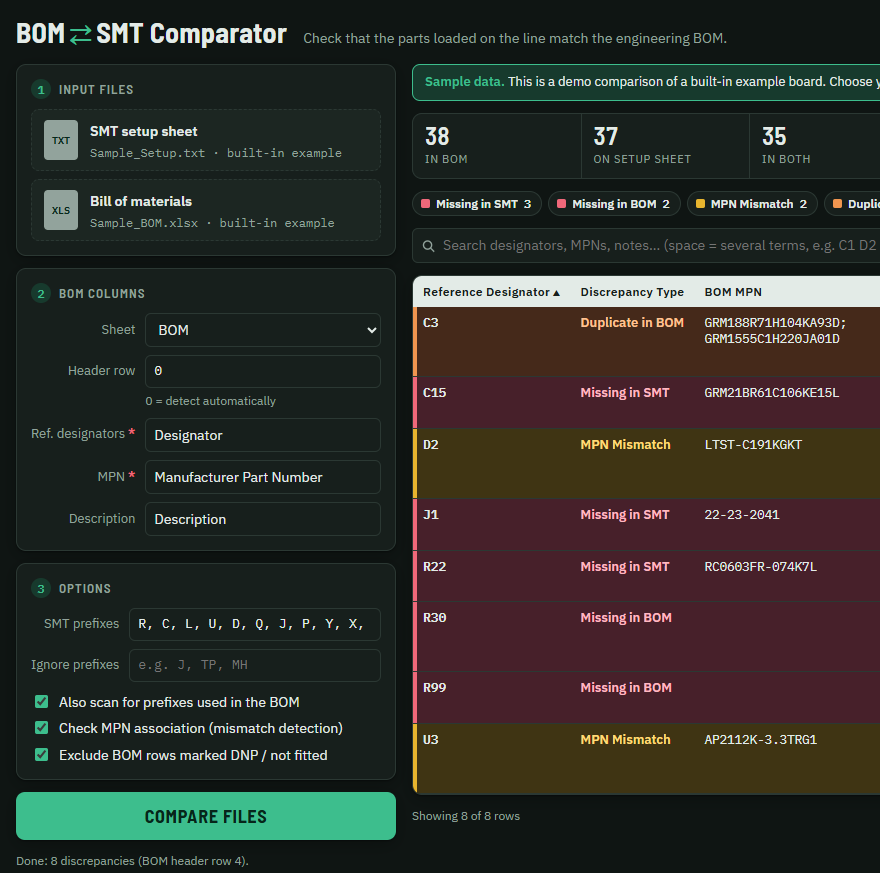

# BOM SMT Comparator

Browser tool that checks an SMT setup sheet against an engineering BOM. It is HTML and JavaScript only. Files stay on your PC; nothing is uploaded to a server.

There are two copies of the same app:

| Path | What it is |
| --- | --- |
| `BOM_SMT_Comparator.html` | Single file. Double-click to open in Chrome or Edge. |
| `web/` | Same app split into HTML, CSS, and JS. Open `web/index.html` in Chrome or Edge. |

## What you need

- Chrome or Edge

Supported inputs:

- **SMT setup sheet:** `.txt`, `.log`, or a text-based `.pdf` (not a scanned image)
- **BOM:** `.xlsx`, `.xls`, or `.xlsm`

## How to run

1. Download or clone this repo.
2. Double-click `BOM_SMT_Comparator.html`, **or** open `web/index.html` in Chrome or Edge.
3. The app loads with a built-in sample comparison.

To pin it to the Windows desktop: right-click `BOM_SMT_Comparator.html` → **Show more options** → **Send to** → **Desktop (create shortcut)**.

## How to compare files

1. Wait for the sample comparison to load, or skip it by dropping your own files.
2. Drop or click to choose the **SMT setup sheet** (left, first drop zone).
3. Drop or click to choose the **BOM Excel** file.
4. Check **Sheet**, **Header row**, **Ref. designators**, and **MPN**. Header row `0` means auto-detect.
5. Adjust prefixes if your designators are not the usual `R`, `C`, `U`, and so on.
6. Click **Compare files**.
7. Filter or search the discrepancy table. Click **Export to Excel** to save a report.

Discrepancy types:

- **Missing in SMT** — in the BOM, not on the setup sheet
- **Missing in BOM** — on the setup sheet, not in the BOM (including DNP parts that were loaded)
- **MPN Mismatch** — same designator, different part number
- **Duplicate in BOM** / **Duplicate in SMT** — the same designator listed more than once

## Notes

- Password-protected workbooks and PDFs are not supported. Save an unprotected copy first.
- Image-only PDFs need OCR first, or export the setup sheet as text from the SMT software.
- The app runs fully in the browser. Your BOM and setup files never leave the machine.
