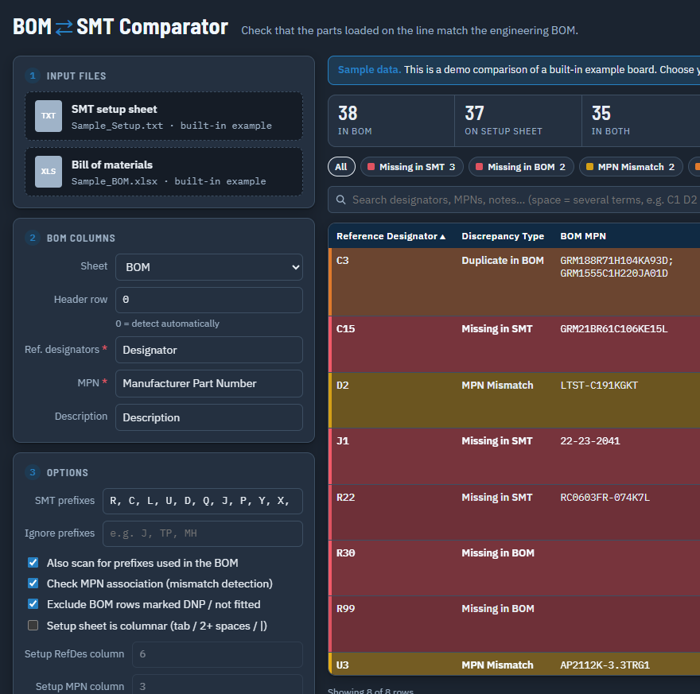

# BOM SMT Comparator

Browser tool that checks an SMT setup sheet against an engineering BOM. It is HTML and JavaScript only. Files stay on your PC; nothing is uploaded to a server.

The layout matches the Python desktop app: blue shop-floor theme, **Dark mode**, clickable type chips, and an optional columnar setup-sheet mode. **Ctrl+Enter** compares; **Ctrl+E** exports.

There are two copies of the same app:

| Path | What it is |
| --- | --- |
| `BOM_SMT_Comparator.html` | Single file. Double-click to open in Chrome or Edge. |
| `web/` | Same app split into HTML, CSS, and JS. Open `web/index.html` in Chrome or Edge. |

## Python vs JavaScript

There is a matching desktop app: [BomCompare_Python](https://github.com/sran4/BomCompare_Python). Both use the same comparison rules (missing, MPN mismatch, duplicates, DNP). Pick one:

| | JavaScript (this repo) | Python |
| --- | --- | --- |
| **Best when** | Sharing a file or a quick look with no install | Daily use on a line PC you control |
| **How you run it** | Double-click `BOM_SMT_Comparator.html` in Chrome or Edge | `python bom_smt_comparator.py` after a one-time venv |
| **Install** | None | Python 3.12 + `pip install -r requirements.txt` |
| **Sample on start** | Yes — built-in demo with a “Sample data” banner | No — you choose files |
| **PDF / Excel** | PDF.js, SheetJS, ExcelJS in the page | pdfplumber (and pypdf fallback), pandas/openpyxl |
| **Settings** | Remembered in the browser (localStorage) | Remembered in Windows (window size, prefixes, dark mode) |

**JavaScript — pros**

- Zero install; one HTML file or the `web/` folder.
- Opens with a sample so new users see chips, filters, and a real table immediately.
- Easy to put on a share or GitHub for anyone with a browser.

**JavaScript — cons**

- The single-file HTML is very large (libraries are inlined).
- Relies on the browser; a blocked or slow script load can delay the first compare.
- Weaker fit as the always-on tool on an SMT station.

**Python — pros**

- Stays up as a normal Windows window (drop files, shortcuts, export).
- Header auto-detect and PDF text extract were solid on the shared test BOMs.
- No wait for large in-page spreadsheet libraries.

**Python — cons**

- Must install Python and packages on each PC.
- No demo comparison until you pick files.
- Not something you email as a single double-click file.

Use **this JavaScript app** to try the tool or send it to someone without Python. Use **Python** on the machine that compares production BOMs.

## What you need

- Chrome or Edge

Supported inputs:

- **SMT setup sheet:** `.txt`, `.log`, or a text-based `.pdf` (not a scanned image)
- **BOM:** `.xlsx`, `.xls`, or `.xlsm`

## How to run

1. Download or clone this repo.
2. Double-click `BOM_SMT_Comparator.html`, **or** open `web/index.html` in Chrome or Edge.
3. The app loads with a built-in sample comparison.

To pin it to the Windows desktop: right-click `BOM_SMT_Comparator.html` → **Show more options** → **Send to** → **Desktop (create shortcut)**.

## How to compare files

1. Wait for the sample comparison to load, or skip it by dropping your own files.
2. Drop or click to choose the **SMT setup sheet** (left, first drop zone).
3. Drop or click to choose the **BOM Excel** file.
4. Check **Sheet**, **Header row**, **Ref. designators**, and **MPN**. Header row `0` means auto-detect.
5. Adjust prefixes if your designators are not the usual `R`, `C`, `U`, and so on.
6. Click **Compare files** (or press Ctrl+Enter). Use **Dark mode** if you prefer the shop-floor theme.
7. Filter or search the discrepancy table, or click a colored chip. Click **Export to Excel** (or press Ctrl+E) to save a report. For machine dumps with a fixed designator column, turn on **Setup sheet is columnar**.

Discrepancy types:

- **Missing in SMT** — in the BOM, not on the setup sheet
- **Missing in BOM** — on the setup sheet, not in the BOM (including DNP parts that were loaded)
- **MPN Mismatch** — same designator, different part number
- **Duplicate in BOM** / **Duplicate in SMT** — the same designator listed more than once

## Notes

- Password-protected workbooks and PDFs are not supported. Save an unprotected copy first.
- Image-only PDFs need OCR first, or export the setup sheet as text from the SMT software.
- The app runs fully in the browser. Your BOM and setup files never leave the machine.
